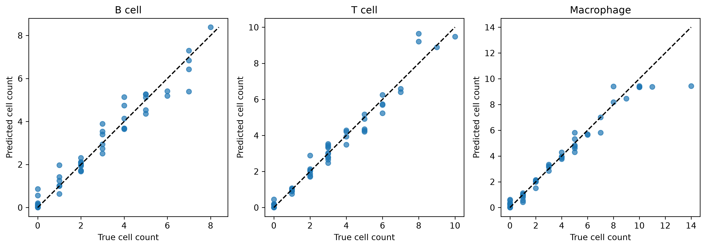
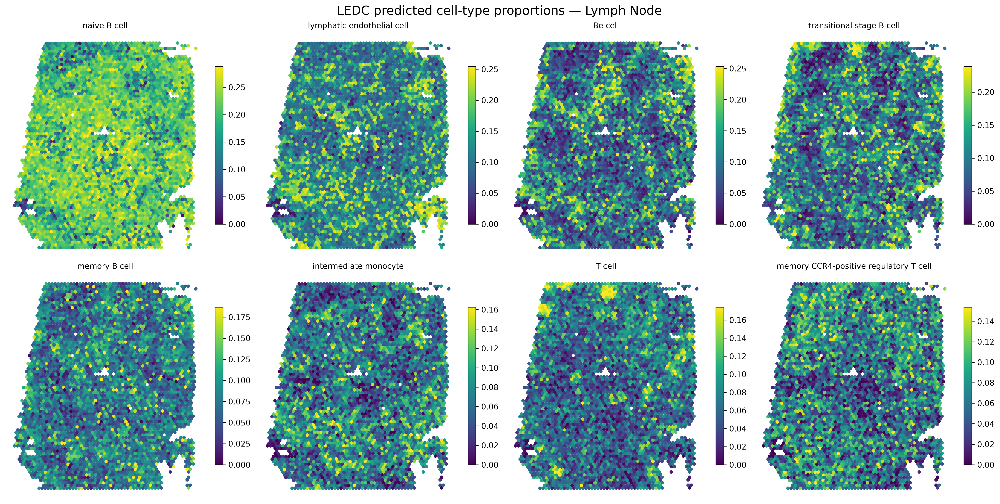

# LEDC: LightGBM Ensemble DeConvolution

**LEDC** is a supervised machine-learning method for estimating cell-type abundance from bulk RNA sequencing and spatial transcriptomics data.

LEDC trains independent LightGBM regression models for each cell type using pseudobulk mixtures generated from annotated single-cell RNA-seq data. It supports both cell-type count and proportion prediction, with an emphasis on count-based deconvolution for spatial transcriptomics.

## Installation

Clone the repository and install LEDC:

```bash
git clone https://github.com/yijiaxue1202/LEDC
cd LEDC
python -m pip install -e .
```

## Main features

- Generate pseudobulk training mixtures from annotated single-cell RNA-seq data.
- Predict cell-type counts or proportions using independent LightGBM regression models.
- Select boosting rounds using cross-validation with early stopping.
- Save and load trained models for reuse.
- Evaluate predictions using Pearson correlation and RMSE.
- Visualize predicted cell-type abundance in spatial transcriptomics data.

## Example: Running LEDC on Synthetic Data

A reproducible demonstration is provided in [`examples/demo_ledc.py`](examples/demo_ledc.py). This example illustrates the complete LEDC workflow using simulated single-cell RNA-seq data with three cell types: B cells, T cells, and macrophages.

The demo generates pseudobulk mixtures, trains independent LightGBM models for cell-type count prediction, and evaluates the predictions on held-out synthetic samples.

### Run the demo

After installing LEDC, run the following command from the repository root:

```bash
python examples/demo_ledc.py
```

### Example code

```python
from ledc import LEDC, generate_pseudobulk, evaluate_predictions
import numpy as np
import pandas as pd

# adata: simulated AnnData containing raw counts and cell-type labels
# cell_types: ["B cell", "T cell", "Macrophage"]

T_train, C_train, _ = generate_pseudobulk(
    adata,
    n_samples=200,
    cell_types=cell_types,
    rng=np.random.default_rng(42),
    mode="count"
)

X_train = pd.DataFrame(T_train.toarray(), columns=adata.var_names)

# Train LEDC
model = LEDC(target="count", n_estimators=100)
model.fit(X_train, C_train)

# Predict on a separately generated test mixture dataset
predictions = model.predict(X_test)

# Evaluate predictions
scores = evaluate_predictions(C_test, predictions)
print(scores.round(3))
```

The complete script includes the creation of `adata`, `X_test`, and `C_test`.

### Example output

**Predicted cell-type counts (first five samples):**

| Sample | B cell | T cell | Macrophage |
|---|---:|---:|---:|
| 0 | 2.94 | 3.53 | 0.41 |
| 1 | 4.14 | 6.58 | 1.13 |
| 2 | 4.74 | 0.45 | 9.35 |
| 3 | 0.03 | 9.65 | 0.25 |
| 4 | 1.93 | 2.66 | 3.23 |

**Prediction performance:**

| Cell type | Pearson | RMSE |
|---|---:|---:|
| B cell | 0.978 | 0.481 |
| T cell | 0.984 | 0.456 |
| Macrophage | 0.978 | 0.805 |
| Mean by sample | 0.993 | 0.452 |

### Visualization

The figure compares predicted and true cell-type counts for each cell type. The dashed line represents perfect agreement.



*Note: The example uses synthetic data and is intended to demonstrate package functionality, not biological generalization. Training and test mixtures are generated separately from the same underlying single-cell reference.*

For the complete executable example, see [`examples/demo_ledc.py`](examples/demo_ledc.py).

## Quick start

### 1. Generate pseudobulk training data

The input is an AnnData object containing raw single-cell counts and cell-type annotations stored in `adata.obs["cell_type"]`.

```python
import numpy as np
import pandas as pd
from ledc import generate_pseudobulk

T, C, P = generate_pseudobulk(
    adata=adata,
    n_samples=500,
    cell_types=cell_types,
    rng=np.random.default_rng(42),
    mode="count",
    poisson_mean=10
)

X_train = pd.DataFrame(
    T.toarray(),
    columns=adata.var_names
)

Y_train = C
```

The function returns:

- `T`: pseudobulk gene expression (samples × genes)
- `C`: cell-type counts (samples × cell types)
- `P`: cell-type proportions (samples × cell types)

The DataFrame conversion shown above is suitable for small datasets. Large datasets may require a memory-efficient sparse workflow.

### 2. Train LEDC

```python
from ledc import LEDC

model = LEDC(target="count")
model.fit(X_train, Y_train)
```

LEDC trains a separate LightGBM regression model for each cell type.

### 3. Predict cell-type abundance

```python
predictions = model.predict(X_test)
print(predictions.head())
```

`X_test` must contain compatible expression measurements and the training genes. LEDC aligns gene columns to the training order.

### Predict directly from AnnData

LEDC also supports prediction from AnnData objects, commonly used for single-cell RNA-seq and spatial transcriptomics datasets.

The `predict_adata()` method automatically aligns genes with the training data, handles sparse expression matrices, and performs predictions in batches.

```python
import anndata as ad
from ledc import LEDC

# Load spatial expression data
adata = ad.read_h5ad("spatial_data.h5ad")

# Load trained LEDC models
model = LEDC.load("saved_models")

# Predict cell-type abundances
predictions = model.predict_adata(
    adata,
    gene_id_column="gene_ids",
    batch_size=128,
    missing_genes="error"
)

print(predictions.head())
```

The resulting DataFrame contains samples or spatial spots as rows and predicted cell types as columns. Sample identifiers from `adata.obs_names` are preserved.

The `gene_id_column` argument specifies the column in `adata.var` containing gene identifiers. If omitted, LEDC uses `adata.var_names`.

By default, all training genes must be present. Set `missing_genes="zero"` to explicitly fill missing training genes with zeros.

**Note:** Expression preprocessing should be compatible with the training data.


### 4. Save and load trained models

```python
model.save("saved_models")

loaded_model = LEDC.load("saved_models")
predictions = loaded_model.predict(X_test)
```

### 5. Evaluate predictions

```python
from ledc import evaluate_predictions

scores = evaluate_predictions(Y_test, predictions)
print(scores)
```

Evaluation includes Pearson correlation and RMSE by cell type and mean sample-level metrics. Count predictions are evaluated without proportion normalization.

### 6. Visualize spatial predictions

```python
from ledc import plot_spatial

fig = plot_spatial(
    predictions=predictions,
    coordinates=spatial_positions,
    cell_types=["B cell", "T cell"],
    ncols=2,
    cmap="viridis",
    scale="shared",
    vmax="max",
    tissue_only=True,
    spot_size=13,
    save_path="spatial_maps.png",
    show=False,
)

```

The spatial positions DataFrame must contain `pxl_col_in_fullres` and `pxl_row_in_fullres`. The optional `in_tissue` column identifies tissue spots. Spot indices should match prediction indices.

### Example: Spatial deconvolution with LEDC

Once LEDC models have been trained, they can be applied to spatial transcriptomics data to estimate cell-type abundances across tissue locations.

```python
import anndata as ad
import pandas as pd
import matplotlib.pyplot as plt

from ledc import LEDC, plot_spatial

# Load trained models
model = LEDC.load("saved_models")

# Load spatial gene expression
adata = ad.read_h5ad("visium_data.h5ad")

# Predict cell-type abundances
predictions = model.predict_adata(
    adata,
    gene_id_column="gene_ids"
)

# Load spatial coordinates
positions = pd.read_csv("tissue_positions.csv")

# Select cell types for visualization
selected_types = predictions.columns[:8].tolist()

# Plot predicted cell-type abundances
fig = plot_spatial(
    predictions=predictions,
    coordinates=positions,
    cell_types=selected_types,
    ncols=4,
    cmap="viridis",
    scale="individual",
    vmax="quantile",
    quantile=0.99,
    tissue_only=True,
    spot_size=20
)

fig.savefig(
    "spatial_predictions.png",
    dpi=300,
    bbox_inches="tight"
)

plt.close(fig)
```

The spatial coordinate table should contain spot barcodes and the columns `pxl_col_in_fullres` and `pxl_row_in_fullres`. LEDC aligns predictions and coordinates using their spot identifiers.

The `scale` parameter supports:

- `"individual"`: separate color ranges for each cell type.
- `"shared"`: a common color range for comparing predicted abundances between cell types.

Users may also specify individual cell types, change the colormap, filter tissue spots, or provide a histology background image with an appropriate coordinate transformation.


### Example: Human lymph-node Visium data

The figure below illustrates the application of LEDC to a human lymph-node Visium dataset. Using trained LightGBM models, LEDC predicts cell-type abundances for 4,015 spatial spots across 39 cell types.

Eight cell types are shown to demonstrate the spatial distribution of predicted abundances across the tissue.



A complete application using a human lymph-node Visium dataset is provided in [`examples/predict_lymph.py`](examples/predict_lymph.py). This example requires separately obtained data and trained model files.
## Input data requirements

LEDC expects gene-expression matrices with samples or spatial spots as rows and genes as columns. Training targets contain cell-type counts or proportions, with one column per cell type.

The training and prediction datasets should use compatible gene identifiers and expression preprocessing. Gene alignment alone does not resolve differences between experimental platforms or tissue distributions.

## Reproducibility

LEDC supports configurable random seeds, cross-validation, and model saving. For donor-aware evaluation, separate donors into training and testing datasets before pseudobulk generation or model training.

## Development

To install development dependencies and run the tests:

```bash
python -m pip install -e ".[dev]"
python -m pytest -q
```

To build distribution files:

```bash
python -m build
```

## Citation

A manuscript describing LEDC is in preparation. Citation details will be added when available.

## License

License information will be finalized before public release.
